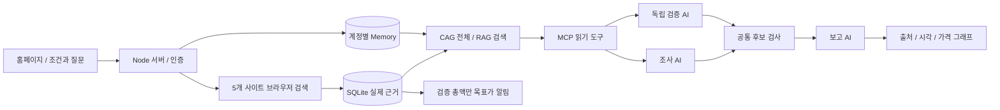

# 여정 레이더 2.0

반복적인 항공권 비교와 목표가 감시를 돕는 수업 프로젝트입니다. 트립닷컴을 메인으로 구글 항공편·스카이스캐너·카약·하나투어의 검색 표시가를 비교합니다. 저장 조건의 출국·귀국 출발/도착 시간을 각각 지정할 수 있습니다.

## 실행

Node.js 24 이상과 Chrome을 설치하고 이 폴더에서 `npm ci`, `npm start`를 실행합니다. 브라우저에서 http://127.0.0.1:8765/ 에 접속하여 로컬 계정을 만듭니다. 기존 설치에 덮어쓸 때 runtime과 private 폴더를 보존하세요. 사용자 DB와 비밀번호·메일 설정은 소스에 포함하지 않습니다.

AI 비교는 이 PC의 공식 Codex CLI가 **ChatGPT 계정으로 로그인된 상태**여야 합니다. `codex login status`로 확인합니다. API 키를 자동 대체 사용하지 않으며 구독 사용 한도는 적용됩니다. 소스만 옮긴 다른 PC에서는 Codex 로그인도 다시 필요합니다.

## 사용하는 순서

1. 감시 조건을 저장하고 항공권 검색을 실행합니다. 검색이 끝나야 분석할 실제 자료가 생깁니다.
2. **여행 분석실 2.0**에서 조건을 선택하고 실제 기록의 가격 그래프를 확인합니다.
3. 여행 선호를 저장하면 다음 AI 비교에 반영됩니다. ‘이 선호로 새 조건 만들기’로 재사용할 수도 있습니다. 기존 조건을 자동 변경하지 않습니다.
4. CAG(최신 회차 전체 자료) 또는 RAG(가중 단어 검색으로 관련 자료 최대 8개)를 선택하고 질문합니다. 전송 동의 후 ‘AI 비교’를 실행합니다.
5. 조사·독립 검증·보고 담당이 서로 다른 Codex 대화에서 실제 MCP 자료를 조회합니다. 조사와 검증의 공통 후보만 보고합니다. 원본 출처와 수집 시각을 확인하세요.
6. MCP 연결 검사와 실행 기록에서 도구 호출·출처 ID·각 역할 대화 ID를 확인할 수 있습니다.

## 수업 기술과 구현

| 기술 | 구현 | 수업 자료 |
|---|---|---|
| 코딩 AI 에이전트 | AI가 구현하고 테스트를 실행한 소스와 검증 기록 | AIagent 18–19쪽 |
| SQLite 데이터베이스 | 검색 근거·선호·AI 보고·도구 호출 기록을 영구 저장 | AIagent 33쪽 |
| Python 시각화 | tools/export-charts.py의 matplotlib 실제 가격 그래프 | AIagent 20–21쪽 |
| Memory | 계정별 명시적 선호 저장·수정·비우기·재사용 | AIagent2 18쪽 |
| 긴 컨텍스트/CAG | 최신 검색 회차 자료 최대 40개를 고정한 컨텍스트 | AIagent2 14–15쪽 |
| 검색 기반 생성/RAG | 질문과 관련 자료를 단어 가중 검색 후 근거로 제공 | AIagent2 16–17쪽 |
| MCP | 공식 SDK stdio 서버, 역할별 읽기 도구와 실제 호출 | AIagent3 2–5쪽 |
| 멀티 에이전트 | 독립 조사·감사 후 공통 후보를 작성자가 보고 | AIagent3 13–16쪽 |
| Git | 로컬 소스 변경 이력 | AIagent 34쪽 |

쪽수는 PDF 페이지 기준입니다. RAG는 **신경망 임베딩을 쓰지 않는 단어 검색 구현**입니다. CAG는 자료를 컨텍스트에 제공하는 구현이며 모델 서버의 프롬프트 캐시 적중을 검증했다는 뜻은 아닙니다. 모든 항공사 전수 검색을 보장하지 않습니다.

## 구조

## 검증 및 제한

`npm run test:course`는 모듈과 UI를 검사합니다. `node --test`는 기존 기능의 회귀 검사를 포함합니다. 테스트 안의 모형 모델은 테스트용이며 실제 모델 실행 증거와 구별합니다. 실제 CAG/RAG의 세 역할 모델 호출과 MCP 도구 호출은 별도 검증했습니다.

- 검색 표시가는 위탁수하물·수수료·할인 조건을 모두 확정한 결제 총액이 아닙니다. 최종 총액 검증 어댑터가 미완성이므로 그 표시가만으로 목표가 이메일을 보내지 않습니다.
- 기록은 수집 시각의 자료입니다. 15분이 넘은 자료에는 오래된 기록 표시를 붙입니다. 예측 가격이나 확인되지 않은 항공편을 생성하지 않습니다.
- 클라우드 배포 여부는 설치마다 다릅니다. 홈페이지의 무료 클라우드 감시 탭에서 실제 배포·예약·최근 실행 상태를 확인하세요. 로컬 감시는 PC를 끄면 멈추지만 배포된 GitHub Actions 감시는 별도로 실행됩니다. 조건이나 이메일을 수정하면 클라우드 반영 버튼을 눌러야 합니다.
- 무료 클라우드 검색과 로컬 Codex AI 분석은 실행 환경이 다릅니다. Codex 로그인 파일을 공개 저장소나 클라우드 Secret으로 복사하지 마세요.
- FormSubmit 자체의 최초 인증 메일 문구는 서비스가 정합니다. 프로그램이 보내는 알림 내용은 한국어입니다. 접수와 받은편지함 도착은 구별됩니다.
- 과제의 ‘본인이 정답을 확인한 5개 사례’와 ‘실제 AI 오답 사례 및 원인 분석’은 작성자가 확인하여 보고서에 추가해야 합니다. 5개 사이트를 조회한 것은 5개의 검증 사례를 대신하지 않습니다.

## 그래프 내보내기

`python -m pip install -r requirements-plot.txt` 후 `python tools/export-charts.py --input chart-data.json --output prices.png`로 실행합니다. 입력은 `/api/course/charts?taskId=...`에서 인증 후 얻는 JSON 형식입니다. DB나 개인 메모를 공개 제출하지 마세요.

## 클라우드 배포와 상태 확인

`cloud/deploy.mjs`는 공식 GitHub CLI 로그인 후 공개 저장소에 Git 추적 소스만 게시하고 현재 설정을 암호화된 GitHub Actions Secret으로 등록합니다. 소스 수정은 먼저 로컬 Git에 커밋해야 합니다. `FLIGHT_GH_BIN`으로 설치된 CLI 실행 파일을 지정할 수 있습니다. 로그인 설정은 runtime/github-cli에 보관되며 공개 소스에서 제외됩니다.

홈페이지의 ‘현재 조건·이메일을 클라우드에 반영’은 Secret을 갱신합니다. ‘상태 새로고침’은 실제 GitHub 실행 결과를 조회합니다. 조회 실패 시 마지막 확인 기록임을 표시합니다. GitHub에 호스팅되는 것은 예약 검색 작업이며 이 로컬 홈페이지 자체가 공개 웹사이트로 배포되는 것은 아닙니다. Codex AI 분석은 여전히 로컬 로그인 환경에서 실행합니다.
